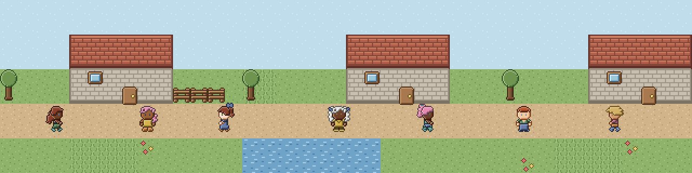

<p align="center">
  
</p>

# pixel-kit

Small, composable pieces for pixel-art games and apps, from [ragTech](https://ragtechdev.com). Everything is built from fixed masks and fixed palettes, so it stays small, consistent and safe to hand to players.

| Package | What it is | Docs |
|---|---|---|
| [`@ragtechdev/pixel-sprites`](packages/pixel-sprites) | Avatars, tiles, objects, icons and small worlds, composed from string masks and fixed palettes. Renders to SVG, canvas or React. | [README](packages/pixel-sprites/README.md) |
| [`@ragtechdev/pixel-engine`](packages/pixel-engine) | A framework-agnostic game runtime for tile-based worlds: a fixed-step loop, input, a camera, tile movement with collision, and scenes. Uses `pixel-sprites`. | [README](packages/pixel-engine/README.md) |

The **studio** browses everything in the library: icons, tiles, objects, avatars and worlds, with copyable code and downloads. It is live at <https://ragtechdev.github.io/pixel-kit/>, or run it locally with `pnpm dev`.

## Using the packages

Each package's README has its install steps and examples. They are separate npm packages with their own versions and changelogs, so you install only what you need.

## Working on the kit

You need Node 20 or newer and [pnpm](https://pnpm.io) (the version is pinned in `package.json`).

```sh
pnpm install --frozen-lockfile
pnpm dev         # the studio
pnpm typecheck   # every package and the studio
pnpm test        # every package
pnpm size        # gzipped size per entry
pnpm build       # build every package
```

Adding art (an icon, a garment, a hair style, an object or a tile) has a scaffolding wizard, `pnpm new`. See [CONTRIBUTING.md](CONTRIBUTING.md) for how to contribute and the rules that keep the kit small.

## Licences

- **Code** is MIT, see [LICENSE](LICENSE).
- **Art** in `pixel-sprites` is CC BY 4.0, see [packages/pixel-sprites/LICENSE-ART.md](packages/pixel-sprites/LICENSE-ART.md) for what it covers and how to credit it.
