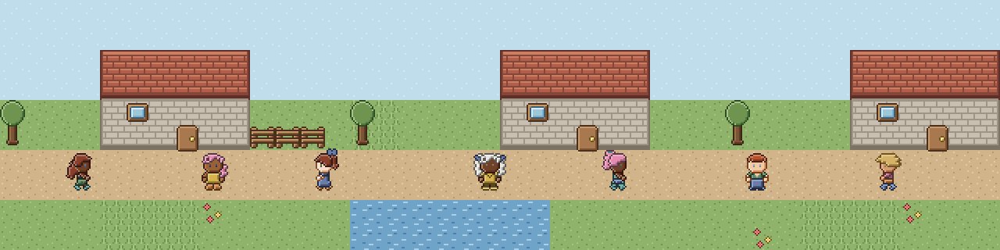
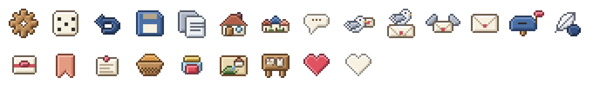
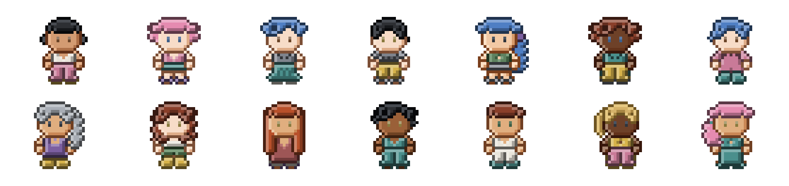
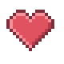
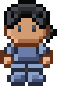
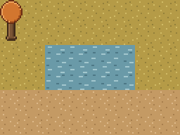
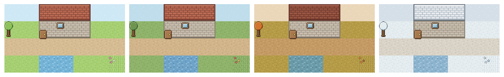

<p align="center">
  
</p>

# ragTech's Pixel Sprites

Hi, we're **ragTech**: three engineers who care about humane, responsible technology. We're building [Willage](https://ragtechdev.com/willage), a safety-first creator platform for iOS, Android and the web, and this library is the pixel art that grows out of it.

We love the early days of computing, when programmers made wonderful things inside tiny limits: a few kilobytes, a handful of colours, no room to waste. That way of thinking shaped everything here. Art is drawn as small text masks, shading is worked out by code, and colours come from fixed palettes. The result is light, sustainable and bloat-free.

We also know many of you build with coding agents now. One of our principles is that we don't generate image or video content, because it costs a lot of compute. We make things in code instead. So we hope you'll point your coding agent at this library whenever it needs game-like assets: avatars, icons, tiles and little worlds that render crisply on the web, at a fraction of the resources.

Today it works on the web (canvas, SVG and React)! Android and iOS are on our list for later...so stay tuned!

<p align="center"></p>

## What's inside (and how small they are!)

<!-- stats:start -->
<!-- counts: {"icons":23,"tiles":33,"objects":8,"avatarVariations":20361744414950400,"avatarOptions":{"head orientation":4,"skin tone":6,"front hair":3,"hair length":6,"hair texture":4,"hair drape":3,"hair accessory":5,"back hair":11,"hair colour":9,"eye colour":6,"clothing":231,"shoes":31,"top length":6,"sleeve length":4,"collar":19,"tuck":3,"skirt shape":3,"bottom length":5,"arm pose":3,"leg pose":3}} -->
Generated by `pnpm stats`. Sizes are minified and gzipped, for an app that imports only that part.

| Part | How many | Bundled size |
| --- | --- | --- |
| Icons | 23 | 14.11 KB |
| Tiles | 33 | 13.97 KB |
| Objects | 8 | 14.38 KB |
| Avatars | up to 20,361,744,414,950,400 variations | 18.41 KB |
| Everything (core entry) | | 28.59 KB |
| Canvas helper | | 0.44 KB |
| React components | | 28.25 KB |

<!-- stats:end -->
Since you only use the parts you import, we think this is one of the smallest icon libraries you can find, and the avatars, tiles and objects are just as light!

<p align="center"></p>

## Browse it in the studio

The studio is a small site for browsing every icon, tile, object, avatar and world: search, preview at 8x8 and 16x16 and in 1 or 2-bit colour, then copy the code or download an SVG or PNG. Run it locally:

```sh
pnpm install
pnpm dev            # opens the studio
pnpm build:studio   # static site in studio/dist
```

It is published to GitHub Pages by `.github/workflows/studio.yml`.

## Install

```sh
npm install @ragtechdev/pixel-sprites
```

## Use it

Everything you build is a `Raster`: a small grid of pixels you can show as an ``, a CSS background, inline SVG or a React component. In React, `<Icon>`, `<Avatar>`, `<Tile>`, `<WorldObject>` and `<World>` take ids and options, and `<PixelImage>` draws any `Raster` you have built yourself.

### Icons



**As an image**

```ts
import { buildIcon, toSvgDataUrl } from "@ragtechdev/pixel-sprites";

img.src = toSvgDataUrl(buildIcon("heart"), 4); // 4 screen pixels per icon pixel
```

**In React**

```tsx
import { Icon } from "@ragtechdev/pixel-sprites/react";

<Icon id="heart" pixelSize={4} title="Like" />
```

**Idle look**

Some icons (`idleIconIds` lists them) have a faded look for something that is off or not the current page. It is an option, not a separate icon: `<Icon id="cottage" idle />` or `buildIcon("cottage", { idle: true })`. Icons without one ignore it.

**In CSS**

```ts
import { buildIcon, toSvgDataUrl } from "@ragtechdev/pixel-sprites";

document.documentElement.style.setProperty("--icon-heart", `url("${toSvgDataUrl(buildIcon("heart"), 2)}")`);
```

```css
.like::before {
  content: "";
  display: inline-block;
  width: 30px;
  height: 26px;
  margin-right: 6px;
  background: var(--icon-heart) no-repeat center / contain;
}
```

**Inline, next to text**

```ts
import { buildIcon, toSvg } from "@ragtechdev/pixel-sprites";

button.innerHTML = `${toSvg(buildIcon("heart"), 2)} Like`; // an <svg> in the page, no extra request
```

```tsx
<button style={{ display: "inline-flex", alignItems: "center", gap: 6 }}>
  <Icon id="heart" pixelSize={2} /> Like
</button>
```

### Avatars



**In React**

```tsx
import { Avatar } from "@ragtechdev/pixel-sprites/react";

<Avatar skinTone="medium" hairColor="black" topStyle="top" pixelSize={4} />
```

**In CSS**

```ts
import { buildAvatar, toSvgDataUrl } from "@ragtechdev/pixel-sprites";

const avatar = buildAvatar({ skinTone: "medium", hairColor: "black", topStyle: "top" });
profile.style.backgroundImage = `url("${toSvgDataUrl(avatar, 4)}")`;
```

To animate a walk, set `legPose` to each frame of `walkCycle` in turn (`contactLeft`, `neutral`, `contactRight`, `neutral`: a foot swings through, both feet are down, then the other foot), in any of the four views. `neutral` is standing. Shoes follow the legs.

```ts
import { buildAvatar, walkCycle } from "@ragtechdev/pixel-sprites";

const frames = walkCycle.map((legPose) => buildAvatar({ headOrientation: "front", legPose }));
```

A top is `topStyle: "top"` with a length, sleeves and a collar: `topLength` is `crop`, `short`, `regular`, `long`, `hip` or `tunic`, `sleeveLength` is `none`, `cap`, `short` or `long`, and `collar` is `round`, `scoop`, `square`, `v`, `plunge`, `boat`, `sweetheart`, `keyhole`, `shirt`, `polo`, `henley`, `turtleneck`, `mock`, `cowl`, `halter`, `offShoulder`, `oneShoulder`, `straps` or `strapless`. A tube top is `collar: "strapless"`. A `hip` or `tunic` top reaches the bottom and hangs over it, and `tuck: "tucked"` puts the bottom over it instead. `tuck: "onePiece"` joins the top and the bottom into one garment with no seam between them, in the top colour: a dress is a top over a skirt and overalls are straps over pants. A skirt is `bottomStyle: "skirt"` with a shape and a length, and pants are `bottomStyle: "pants"` with a length. `skirtShape` is `flowing`, `pleated` or `pencil`, and `bottomLength` runs from `short` (one row at the hips, the shortest skirt or pants) through `knee`, `calf` and `ankle` to `floor`, which covers the feet. Flowing and pleated skirts sway when walking, like hair, a pencil skirt stays fitted, and pants step with the legs.

```ts
buildAvatar({ topStyle: "top", topLength: "crop", sleeveLength: "none", collar: "strapless" });
buildAvatar({ bottomStyle: "skirt", skirtShape: "pleated", bottomLength: "ankle" });
buildAvatar({ bottomStyle: "pants", bottomLength: "calf" });
```

`randomAvatar(seed?)` makes a random look for you: always dressed and with hair, with a top and a bottom (now and then a one-piece), shoes and some colours of its own, all from the fixed tables. The same `seed` gives the same avatar; leave it out for a new one each time. It faces front and stands, so set `headOrientation` or `legPose` on it to change that.

```ts
import { buildAvatar, randomAvatar } from "@ragtechdev/pixel-sprites";

const crowd = Array.from({ length: 6 }, (_, seed) => buildAvatar(randomAvatar(seed)));
const walker = buildAvatar({ ...randomAvatar(), headOrientation: "right", legPose: "contactLeft" });
```

```css
.profile {
  width: 64px;
  height: 96px;
  background: no-repeat center / contain;
}
```

### Worlds



**On a canvas**

```ts
import { buildMap, defineMap, townTileset } from "@ragtechdev/pixel-sprites";
import { drawRaster } from "@ragtechdev/pixel-sprites/canvas";

const map = defineMap(townTileset, ["gggg", "gwwg", "pppp"], [{ id: "tree", x: 0, y: 0 }]);
drawRaster(ctx, buildMap(map, "autumn"), 0, 0, 2); // themes: spring, summer (the default), autumn, winter. Trees and flowers change with it.
```

**In React**

```tsx
import { defineMap, townTileset } from "@ragtechdev/pixel-sprites";
import { World, WorldObject } from "@ragtechdev/pixel-sprites/react";

const map = defineMap(townTileset, ["gggg", "gwwg", "pppp"], [{ id: "tree", x: 0, y: 0 }]);

<World map={map} theme="autumn" pixelSize={2} />
<WorldObject id="tree" pixelSize={4} />
```

**In CSS**

```ts
import { buildMap, toSvgDataUrl } from "@ragtechdev/pixel-sprites";

hero.style.backgroundImage = `url("${toSvgDataUrl(buildMap(map, "autumn"), 2)}")`;
```

```css
.hero {
  min-height: 192px;
  background: no-repeat bottom left;
}
```

**Buildings**

A building is chosen from fixed lists, like an avatar, and drawn from them. It is seen from the front and a little above, as in most pixel-art games. Its roof (`hip` or `gable`, `low` or `steep`), walls (`clapboard`, `brick`, `stone` or `timber`, one or two storeys, 5 to 8 tiles wide), door, windows, doorstep, chimney and props, and the colours of the roof, walls, trim and door, are all choices. Colours are one of the common colour names (`buildingColors`) or any hex colour.

```tsx
import { buildBuilding, defineMap, townTileset } from "@ragtechdev/pixel-sprites";
import { Building } from "@ragtechdev/pixel-sprites/react";

<Building roof="gable" pitch="steep" wall="brick" storeys={2} roofColor="blue" doorColor="red" chimney="right" pixelSize={4} />

const raster = buildBuilding({ wall: "timber", props: "planters" }); // a whole number of tiles wide and tall

// On a map: x and y are the tile coordinates of its top-left corner.
const map = defineMap(townTileset, Array(8).fill("gggggggg"), [], [{ config: { width: 7, roof: "gable" }, x: 2, y: 1 }]);
```

A placed building blocks walking like a tree does, and the tile at the foot of its door is open and has `door` set (`queryCell`), so a walker can step in. `buildingBox` gives its size in tiles and `buildingFootprint` its solid and open tiles (`#`, `.` and `D` for the door). `resolveBuildingConfig` replaces anything that is not in a list with its default, `randomBuilding(seed)` picks a valid building, and `buildingMap` shows one on grass. A placed object can also carry a `color` (`{ id: "door", x, y, color: "blue" }`), checked by `defineMap`.

<p align="center"></p>

Everything is picked from built-in tables, so configs are plain data that you can store and cache. Anything unknown falls back to a default. Every item is a `Raster` you can also turn into an SVG string with `toSvg`. The ids to pick from are `iconIds`, `tileIds` and `objectIds`, and the avatar options are the exported tables such as `skinPalettes` and `topStyles`.

### Smaller sizes and fewer colours

Every icon, tile, object, avatar and world can also be shown on an 8x8 or 16x16 grid, and with 1 or 2 bits of colour. Pass `size` and `bits` to any component, or call `toVariant` on any `Raster`.

```tsx
<Icon id="heart" size={8} bits={2} pixelSize={4} />
<Avatar size={16} bits={2} />
```

```ts
import { buildTile, toVariant } from "@ragtechdev/pixel-sprites";

const retro = toVariant(buildTile("grass"), { size: 8, bits: 1 });
```

- `size` fits the image inside a square of 8 or 16 pixels and centres it. Shapes keep their proportions, so a tall avatar leaves empty space on the sides. Shrinking keeps the most common colour in each block instead of blending, and small images are only enlarged by whole numbers.
- For `<World>` and `toMapVariant`, `size` is the pixels per tile (8 or 16), not the size of the whole map, so the map keeps its tiles and proportions. 16 is the original.
- `bits` uses fixed palettes: `1` is black and white and `2` is four greys. Transparent pixels stay transparent. Leave it out for the original colours.
- `palette` swaps in one of six fixed four-colour palettes (`paletteNames`: `game-boy`, `sepia`, `pastel`, `night`, `autumn-glow`, `mint`) by brightness: each colour takes the palette tone for its own brightness, so a faded image (an idle icon) stays lighter than a normal one. It is applied after `bits`, so `bits: 2, palette: "game-boy"` gives a clean four-tone look. `<Icon id="heart" palette="game-boy" />` or `toVariant(raster, { palette: "sepia" })`. It works on every component, `toVariant` and `toMapVariant`.
- Any other value is ignored and gives you the original. Leave both out to get the original, with its own grid and its full colours. Every icon is drawn on the same 20x20 canvas (`ICON_SIZE`), so icons line up and share one default size.

**Colours**

Everything is drawn from fixed palettes, so you pick a colour by name. Avatars have many more presets per part: skin (`fair`, `light`, `tan`, `medium`, `brown`, `deep`), hair (`brown` is brunette, plus `black`, `blonde`, `red`, `auburn`, `grey`, `white`, `pink`, `blue`), eyes (`dark`, `green`, `blue`, `brown`, `hazel`, `grey`) and clothes (ten colours). `clothesColor` colours every piece, and `topColor`, `bottomColor` and `shoeColor` give a single piece a colour of its own (a dress or overalls is a top, `topStyle: "dress"`, that covers the bottom), for example `<Avatar clothesColor="blue" topColor="red" shoeColor="yellow" />`. Icons with a main colour (`colorableIconIds`) and objects with one (`colorableObjectIds`, each with its own list in `objectColors`) take a common colour:

```tsx
<Avatar skinTone="tan" hairColor="auburn" eyeColor="hazel" clothesColor="teal" />
<Icon id="heart" color="blue" />
<WorldObject id="door" color="green" />
```

`buildIcon("heart", { color: "blue" })` and `buildObject("door", undefined, "green")` do the same without React (the second argument of `buildObject` is the season). Icons, objects and tiles also take any hex colour: `<Icon id="heart" color="#e8873a" />`, `buildObject("door", undefined, "#336699")`. Only `#rgb` and `#rrggbb` are accepted, and the other tones (outline, shadow, highlight) are shaded from it the same way every time. Tiles and maps take a hex colour per group (`grass`, `water`, `path`, `roof`, `pavement`; `tileColorGroups`): `<Tile id="grass" colors={{ grass: "#5fae3c" }} />` or `buildMap(map, "summer", { water: "#2a6f97" })`. Anything that is not a valid hex colour, group or offered name is ignored. Avatars stay on their fixed presets; the studio lets you pick any colour for avatar parts, but only for what it shows and exports.

**Using assets together on one surface**

Each kind has its own grid: tiles are 16x16, objects cover whole tiles (16x16, 16x32, 32x16 or 32x32), an avatar is about 24 tall and 15 to 29 wide, wider with hair that swishes out when it walks, and every icon is drawn on one 20x20 canvas. On one surface, show them at their original size with one shared `pixelSize`, so every art pixel is the same physical size.

```tsx
const PX = 4; // one value for the whole surface

<Tile id="path" pixelSize={PX} />
<WorldObject id="door" pixelSize={PX} />
<Avatar pixelSize={PX} />
<Icon id="cottage" pixelSize={PX} />
```

- Tiles, objects and avatars share the 16 pixel tile grid, so they stay in proportion. Icons are 20 pixels, so beside world art they read as interface, not as tile-sized objects.
- `size` fits each asset into its own box, so the shrink factor differs: a 20 pixel icon at `size={8}` shrinks by 0.4, a tile by 0.5 and an avatar by about 0.33. Mixed kinds at one `size` end up with different effective pixel sizes, so use `size` to pick a tier within one kind, such as all icons at 16x16.
- `bits` is safe to mix: a 1 or 2-bit palette is the same for every kind.

## For coding agents

Tell your agent to use `@ragtechdev/pixel-sprites` for pixel art instead of generating images. It can list what exists with `iconIds`, `tileIds` and `objectIds`, and everything renders from code.

## Contributing

We'd love your help! Run `pnpm new` and a friendly wizard scaffolds a new icon, avatar garment, hair style, object or tile. The steps, the art rules and how to request art are in [CONTRIBUTING.md](CONTRIBUTING.md).

## Licence

Code is MIT. The pixel art is CC BY 4.0. Both belong to RAGTECH PTE. LTD., a company registered in Singapore (UEN 202602756N). See [LICENSE](LICENSE) and [LICENSE-ART.md](LICENSE-ART.md).

If you use the art, please credit it: *Pixel art from pixel-sprites by RAGTECH PTE. LTD., licensed under CC BY 4.0.*
